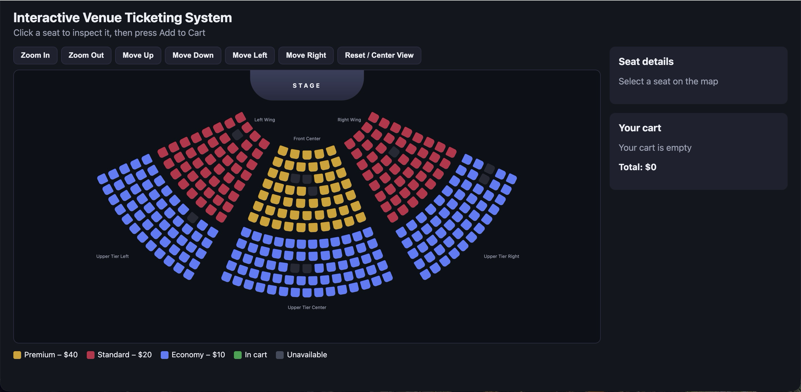

# Interactive Venue Ticketing System

Web & Mobile I student project: an interactive front-end ticket selection website for an auditorium-style venue. Built with plain HTML, CSS and JavaScript (no frameworks, no backend).



## How to run

Open the project folder in VS Code and start `index.html` with the Live Server extension, or open `index.html` directly in a browser. No installation or build step is needed.

## The venue

A fan-shaped auditorium: the rows curve around the stage, with a front center block, left and right wings, and an upper tier of three blocks behind them. Aisles separate the blocks. There are 321 seats in six sections, and 10 of them are marked as already sold.

| Section | Category | Price | Seats |
|---|---|---|---|
| Front Center | Premium | $40 | 53 |
| Left Wing | Standard | $20 | 48 |
| Right Wing | Standard | $20 | 48 |
| Upper Tier Left | Economy | $10 | 53 |
| Upper Tier Center | Economy | $10 | 66 |
| Upper Tier Right | Economy | $10 | 53 |

## Features

- Seats are generated from JavaScript data; no seat is written by hand in the HTML.
- Every seat is a `<button>`. Clicking a seat only inspects it and shows its section, row, seat number, category, price and status.
- Four seat states: available, inspected, in cart, unavailable.
- The ADD TO CART button adds the inspected seat to the cart. The same seat cannot be added twice, and unavailable seats cannot be added.
- The cart lists the tickets with their prices and a total, and each ticket can be removed. Removing a ticket immediately updates the seat on the map.
- The cart is saved in `localStorage` and restored after a refresh together with the matching seat states.
- Zoom In, Zoom Out, Move Up, Move Down, Move Left, Move Right and Reset / Center View buttons, with zoom and pan limits so the map cannot be lost.
- Bonus: mouse-wheel zoom and click-and-drag panning. The buttons stay available.
- Responsive layout: two columns on wide screens, one column on tablets and phones.

## How it works

**Data model (`js/data.js`).** One `VENUE` object holds the map size, the stage position, the three price categories (label, price, colour), the six sections and the list of sold seat IDs. Each section stores its category, number of rows, the radius of its first row, the gap between rows and the angles it covers around the stage.

**Seat generation (`js/app.js`).** For every row, the number of seats is calculated from the length of the arc, so back rows get more seats than front rows. Each seat gets an ID such as `fc-E4` (section, row letter, seat number) and a position from its radius and angle. The seat buttons are then created and placed on the map by JavaScript.

**State.** A seat's state is worked out from three facts: whether it is sold, whether its ID is in the cart, and whether it is the inspected seat. The map, the details panel and the cart are always drawn from the same `cart` array, so they stay in sync.

**Persistence.** The cart (an array of seat IDs) is saved to `localStorage` under the key `venue-ticketing-cart` every time it changes. On load, only IDs that match a real, available seat are restored.

**Navigation.** The whole map is one element. Zoom and pan change its CSS `transform`. The buttons, the mouse wheel and dragging all use the same functions, which apply the limits.

## Project structure

```
index.html
css/style.css
js/data.js
js/app.js
assets/venue.png
README.md
```

## Manual testing

- Clicking a seat shows its details and price; the cart does not change until ADD TO CART is pressed.
- Adding a seat turns it green and adds it to the cart; the same seat cannot be added twice.
- Unavailable seats cannot be added.
- Removing a ticket from the cart immediately updates the seat on the map.
- Refreshing the page restores the cart and the matching seat states.
- All zoom, move and reset controls work and respect their limits; mouse-wheel zoom and drag panning work too.
- The layout was checked at desktop, tablet and phone widths.

## Known limitations

- On a phone the whole venue fits on screen, so the seats are small until you zoom in with the buttons. Pinch-to-zoom is not implemented.
- Sold seats are a fixed list in `data.js`; there is no backend, checkout or real-time availability.
- The cart is stored per browser and per address.